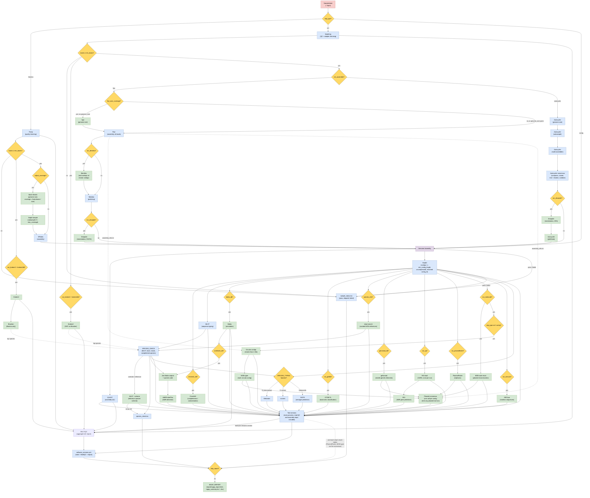

# MGAP Pipeline Workflow Diagram

## Overview

The **gene2dis/mgap** pipeline supports three input modes based on the `--seq_type` parameter: `illumina`, `ont`, or `contig`. Each mode feeds into a shared downstream analysis that includes assembly quality assessment, a per-sample species check, taxonomic classification, gene annotation, antimicrobial resistance detection, plasmid and insertion sequence (IS element) detection, and a run report.

## Full Pipeline Diagram

## Subworkflow Details

### Illumina Subworkflow

| Step | Tool             | Description                                                                                                 |
| ---- | ---------------- | ----------------------------------------------------------------------------------------------------------- |
| 1    | **Fastp**        | Quality trimming of paired-end reads; samples below `--min_bases` stop here (skipped)                       |
| 2    | **Kraken2**      | Contamination detection _(optional, requires `--kraken2db`)_                                                |
| 2b   | **Bracken**      | Abundance re-estimation, read length (`-r`) matched to the reads (`--brackendb`, else the Kraken2 database) |
| 3    | **Mash Sketch**  | Genome size for the coverage estimate (fastp bases ÷ size) _(optional, if `--adjust_coverage`)_             |
| 4    | **Seqtk Sample** | Read subsampling when coverage exceeds `--max_coverage` (default 150x)                                      |
| 5    | **SPAdes**       | _De novo_ genome assembly                                                                                   |

### ONT Subworkflow (Flye mode, default)

| Step | Tool          | Description                                                                                   |
| ---- | ------------- | --------------------------------------------------------------------------------------------- |
| 1    | **fastplong** | Quality filtering and adapter trimming of long reads                                          |
| 2    | **Kraken2**   | Contamination detection _(optional, requires `--kraken2db`; Bracken not run for ONT)_         |
| 3    | **lrge**      | Genome size for Flye _(only with `--flye_asm_coverage` and no `--genome_size`)_               |
| 4    | **Flye**      | _De novo_ long-read assembly from all reads (`--asm-coverage` with `--flye_asm_coverage`)     |
| 5    | **Berokka**   | Trim the end overlap (tandem copies) of Flye's circular contigs _(optional, `--run_berokka`)_ |
| 6    | **Medaka**    | Assembly polishing                                                                            |
| 7    | **Dnaapler**  | Contig reorientation using FASTA input _(optional, `--run_dnaapler`)_                         |

### ONT Subworkflow (Autocycler mode)

| Step | Tool                       | Description                                                                                         |
| ---- | -------------------------- | --------------------------------------------------------------------------------------------------- |
| 1    | **fastplong**              | Quality filtering and adapter trimming of long reads                                                |
| 2    | **Kraken2**                | Contamination detection _(optional, requires `--kraken2db`; Bracken not run for ONT)_               |
| 3    | **Autocycler genome_size** | Genome size estimation via Raven                                                                    |
| 4    | **Autocycler subsample**   | Subsample reads into independent subsets                                                            |
| 5    | **Autocycler assembly**    | Fan-out assembly across multiple assemblers × subsamples (Plassembler only with `--plassembler_db`) |
| 6    | **Autocycler consensus**   | Compress, cluster, trim/resolve, combine (one task, FASTA + GFA)                                    |
| 7    | **Dnaapler**               | Reorient circular contigs using GFA input _(optional, `run_dnaapler`)_                              |
| 8    | **Autocycler gfa2fasta**   | Convert reoriented GFA back to FASTA _(only when Dnaapler is enabled)_                              |

### Shared Downstream Analysis

| Step | Tool                  | Description                                                                                                                                                                      |
| ---- | --------------------- | -------------------------------------------------------------------------------------------------------------------------------------------------------------------------------- |
| 1    | **QUAST**             | Assembly quality metrics (whole assembly)                                                                                                                                        |
| -    | **SeqKit**            | Annotation FASTA: contigs >= `min_contig_length`, uncompressed, renamed `contig_N`; read by every tool below                                                                     |
| 2    | **CheckM2**           | Genome completeness and contamination assessment _(requires `--checkm2_db`)_                                                                                                     |
| 3    | **MLST**              | Multi-locus sequence typing                                                                                                                                                      |
| 3b   | **skani**             | Closest curated NCBI reference _(optional, `--species_refs`)_                                                                                                                    |
| 3c   | **Species check**     | One species decision per sample (MLST, skani, reads, samplesheet): AMRFinderPlus organism and species tools                                                                      |
| 4    | **Bakta**             | Genome annotation _(requires `--bakta_db`)_                                                                                                                                      |
| 5    | **GTDB-Tk**           | Taxonomic classification _(optional)_                                                                                                                                            |
| 6    | **AMRFinderPlus**     | Antimicrobial resistance gene detection (uses Bakta outputs and the species check's organism) _(requires `--bakta_db` and `--amrfinder_db`)_                                     |
| 7    | **geNomad**           | Mobile genetic element identification _(requires `--genomad_db`)_                                                                                                                |
| 8    | **RGI**               | Resistance gene prediction; CARD loaded once per run _(optional)_                                                                                                                |
| 9    | **MOB-suite**         | Plasmid detection and reconstruction _(optional)_                                                                                                                                |
| 9b   | **PlasmidFinder**     | Plasmid replicon detection _(on by default, `--run_plasmidfinder`)_                                                                                                              |
| 9c   | **MOB-typer**         | Types each circular contig shorter than 1 Mb on its own (ONT and contig mode) _(with `--run_mobsuite`)_                                                                          |
| 9d   | **Plasmid consensus** | One plasmid call per contig from PlasmidFinder, geNomad and MOB-suite (and Flye's `assembly_info.txt`) _(when any of them ran)_                                                  |
| 10   | **ISEScan**           | Insertion sequence (IS element) detection _(optional, `--run_isescan`)_                                                                                                          |
| 11   | **MultiQC**           | Aggregate QC report: fastp / fastplong, Kraken2, QUAST and Bakta, plus software versions                                                                                         |
| 12   | **Run report**        | `report/mgap_report.html`, `mgap_summary.tsv` and `.xlsx` from the tool results, `sample_status.tsv`, `species_check.tsv` and `software_versions.yml` _(unless `--skip_report`)_ |

### Taxa-Specific Analysis

| Species                 | Tool          | Description                           |
| ----------------------- | ------------- | ------------------------------------- |
| _Klebsiella pneumoniae_ | **Kleborate** | Virulence and resistance scoring      |
| _Staphylococcus aureus_ | **sccmec**    | SCCmec cassette typing                |
| _Salmonella enterica_   | **SISTR**     | Serovar and cgMLST subtype prediction |
