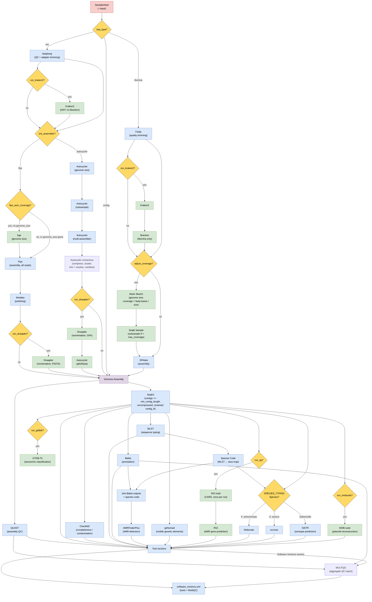

# MGAP Pipeline Workflow Diagram

## Overview

The **gene2dis/mgap** pipeline supports three input modes based on the `--seq_type` parameter: `illumina`, `ont`, or `contig`. Each mode feeds into a shared downstream analysis that includes assembly quality assessment, taxonomic classification, gene annotation, and antimicrobial resistance detection.

## Full Pipeline Diagram

## Subworkflow Details

### Illumina Subworkflow

| Step | Tool             | Description                                                                                      |
| ---- | ---------------- | ------------------------------------------------------------------------------------------------ |
| 1    | **Fastp**        | Quality trimming of paired-end reads                                                             |
| 2    | **Kraken2**      | Contamination detection _(optional, requires `--kraken2db`)_                                     |
| 2b   | **Bracken**      | Abundance re-estimation, read length (`-r`) matched to the reads _(requires a Bracken database)_ |
| 3    | **Mash Sketch**  | Genome size for the coverage estimate (fastp bases ÷ size) _(optional, if `--adjust_coverage`)_  |
| 4    | **Seqtk Sample** | Read subsampling when coverage exceeds `--max_coverage` (default 150x)                           |
| 5    | **SPAdes**       | _De novo_ genome assembly                                                                        |

### ONT Subworkflow (Flye mode, default)

| Step | Tool          | Description                                                                               |
| ---- | ------------- | ----------------------------------------------------------------------------------------- |
| 1    | **fastplong** | Quality filtering and adapter trimming of long reads                                      |
| 2    | **Kraken2**   | Contamination detection _(optional, requires `--kraken2db`; Bracken not run for ONT)_     |
| 3    | **lrge**      | Genome size for Flye _(only with `--flye_asm_coverage` and no `--genome_size`)_           |
| 4    | **Flye**      | _De novo_ long-read assembly from all reads (`--asm-coverage` with `--flye_asm_coverage`) |
| 5    | **Medaka**    | Assembly polishing                                                                        |
| 6    | **Dnaapler**  | Contig reorientation using FASTA input _(optional, `--run_dnaapler`)_                     |

### ONT Subworkflow (Autocycler mode)

| Step | Tool                       | Description                                                                           |
| ---- | -------------------------- | ------------------------------------------------------------------------------------- |
| 1    | **fastplong**              | Quality filtering and adapter trimming of long reads                                  |
| 2    | **Kraken2**                | Contamination detection _(optional, requires `--kraken2db`; Bracken not run for ONT)_ |
| 3    | **Autocycler genome_size** | Genome size estimation via Raven                                                      |
| 4    | **Autocycler subsample**   | Subsample reads into independent subsets                                              |
| 5    | **Autocycler assembly**    | Fan-out assembly across multiple assemblers × subsamples                              |
| 6    | **Autocycler consensus**   | Compress, cluster, trim/resolve, combine (one task, FASTA + GFA)                      |
| 7    | **Dnaapler**               | Reorient circular contigs using GFA input _(optional, `run_dnaapler`)_                |
| 8    | **Autocycler gfa2fasta**   | Convert reoriented GFA back to FASTA _(only when Dnaapler is enabled)_                |

### Shared Downstream Analysis

| Step | Tool              | Description                                                                                                  |
| ---- | ----------------- | ------------------------------------------------------------------------------------------------------------ |
| 1    | **QUAST**         | Assembly quality metrics (whole assembly)                                                                    |
| -    | **SeqKit**        | Annotation FASTA: contigs >= `min_contig_length`, uncompressed, renamed `contig_N`; read by every tool below |
| 2    | **CheckM2**       | Genome completeness and contamination assessment                                                             |
| 3    | **MLST**          | Multi-locus sequence typing                                                                                  |
| 4    | **Bakta**         | Genome annotation                                                                                            |
| 5    | **GTDB-Tk**       | Taxonomic classification _(optional)_                                                                        |
| 6    | **AMRFinderPlus** | Antimicrobial resistance gene detection (uses Bakta + MLST outputs)                                          |
| 7    | **geNomad**       | Mobile genetic element identification                                                                        |
| 8    | **RGI**           | Resistance gene prediction; CARD loaded once per run _(optional)_                                            |
| 9    | **MOB-suite**     | Plasmid detection and reconstruction _(optional)_                                                            |

### Taxa-Specific Analysis

| Species                 | Tool          | Description                           |
| ----------------------- | ------------- | ------------------------------------- |
| _Klebsiella pneumoniae_ | **Kleborate** | Virulence and resistance scoring      |
| _Staphylococcus aureus_ | **sccmec**    | SCCmec cassette typing                |
| _Salmonella enterica_   | **SISTR**     | Serovar and cgMLST subtype prediction |
